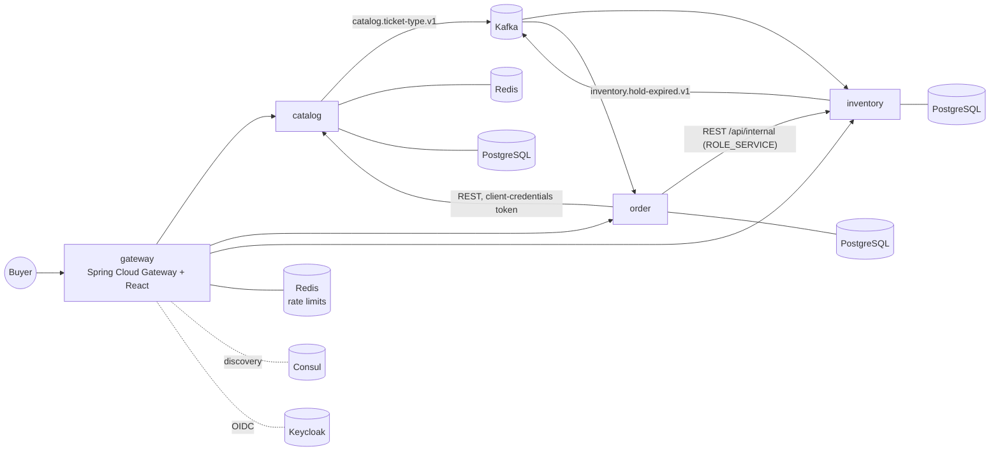

# TicketRush

High-load event ticketing platform built as microservices. Work in progress: phases 1-2 done
(gateway, catalog, inventory, order); payment, saga and outbox come in phase 3.

## What works today

- Browse events and ticket types (catalog, Redis second-level cache)
- Ticket types published by catalog on Kafka; inventory creates and resizes stock from those events
- `POST /services/order/api/checkout` with an `Idempotency-Key`: prices from catalog, seats held 10 minutes in
  inventory, retries return the same order, sold out is a 409
- Holds expire on their own; inventory publishes the expiry and the order becomes EXPIRED
- Overselling is impossible by construction, see [ADR 0003](docs/adr/0003-oversell-prevention.md)
- Checkout is rate limited per user at the gateway (Redis token bucket, 5 per burst then 1/s; 429 with
  `X-RateLimit-*` headers). The limiter fails open: a Redis outage lets requests through instead of taking the
  gateway down
- Stock and order screens in the UI are admin-only and read-only; buyers go through checkout



## Versions

| Component | Version |
|---|---|
| JHipster | 9.4.0 |
| Spring Boot / Spring Cloud | 4.1.1 / 2025.1.3 |
| Java / Node | 21 / 24 |
| PostgreSQL | 18.6 |
| Kafka (KRaft, `apache/kafka-native`) | 4.3.1 |
| Redis | 8.10.1 |
| Keycloak | 26.7.4 |
| Consul | 2.0.4 |

## Run locally

Requirements: Java 21, Node 22.18+ or 24.11+, Docker with about 8 GB of memory.

1. Create the secrets file and fill in real values:

   ```bash
   cp docker-compose/.env.example docker-compose/.env
   ```

2. Add Keycloak to your hosts file, so the browser and the services agree on the token issuer
   (`http://keycloak:9080`):

   ```
   127.0.0.1 keycloak
   ```

3. Build the images:

   ```bash
   for app in catalog inventory order gateway; do (cd $app && ./mvnw -ntp -Pprod -DskipTests verify jib:dockerBuild); done
   ```

4. Start everything:

   ```bash
   docker compose -f docker-compose/docker-compose.yml up -d --wait
   ```

Endpoints: gateway UI http://localhost:8080, Consul http://localhost:8500, Keycloak http://localhost:9080.
Keycloak takes 1-2 minutes to start in dev mode.

## Tests

```bash
(cd inventory && ./mvnw -ntp verify)   # also catalog, order, gateway
```

Integration tests run against real PostgreSQL, Redis and Kafka via Testcontainers. Highlights:

| Test | Proves |
|---|---|
| `ReservationServiceIT` | 200 concurrent buyers for 50 seats: exactly 50 holds, 0 left; mixed-order multi-item orders never deadlock |
| `CheckoutServiceIT` | 8 concurrent retries with the same Idempotency-Key create one order and one reservation |
| `CheckoutRateLimitIT` | the gateway rejects a burst above the limit with 429, per user, without blocking an event-loop thread (BlockHound) |
| `TicketTypeEventsPublisherIT` | catalog publishes only after commit, never for a rolled-back change |

End to end, through the gateway, against the running stack (gateway on port 8088, holds shortened to 20 s):

```bash
docker compose -f docker-compose/docker-compose.yml -f scripts/e2e/compose.override.yml up -d --wait
python scripts/e2e/e2e.py
```

It checks the Kafka stock sync, checkout, idempotent replay, cancel, 40 concurrent buyers for 5 seats over HTTP
(5 x 201, 35 x 409, stock 0), a hold expiring into an EXPIRED order, and the checkout rate limit (22 checks).

## Regenerating code

`ticketrush.jdl` is the source of truth for generated code. JHipster overwrites `docker-compose/` on every run,
so re-apply the local changes afterwards:

```bash
python scripts/harden-compose.py
```

It moves secrets to `.env`, gives the `internal` Keycloak client `ROLE_SERVICE`, fixes single-node Kafka
(without it no consumer group works), configures Consul discovery and adds the gateway's Redis. Entities whose
API is read-only also need their write screens removed: `scripts/make-readonly.py` (REST) and
`scripts/make-readonly-react.py` (gateway UI). Services with hand-written code
(inventory, order, catalog) should be regenerated one entity at a time and reviewed, not with `--force`.

## Repository layout

| Path | Contents |
|---|---|
| `ticketrush.jdl` | Source of truth for generated apps and entities |
| `gateway/` | Spring Cloud Gateway (reactive) + React UI |
| `catalog/` | Venue, Event, TicketType; publishes ticket type events |
| `inventory/` | Stock and seat holds; oversell-safe reservations, hold expiry |
| `order/` | Checkout, my orders, cancel; calls catalog and inventory |
| `docker-compose/` | Local stack: Consul, Keycloak, Kafka, Redis, one PostgreSQL per service |
| `docs/adr/` | Architecture decision records |
| `scripts/` | Post-generation fixes and the end-to-end test |
