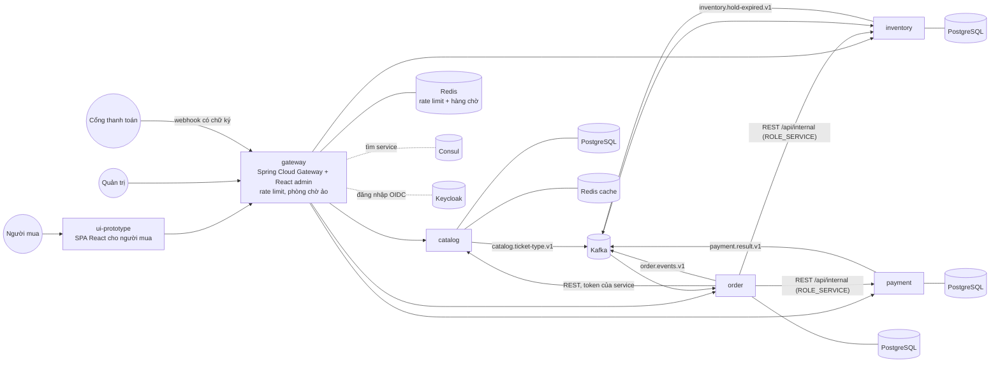
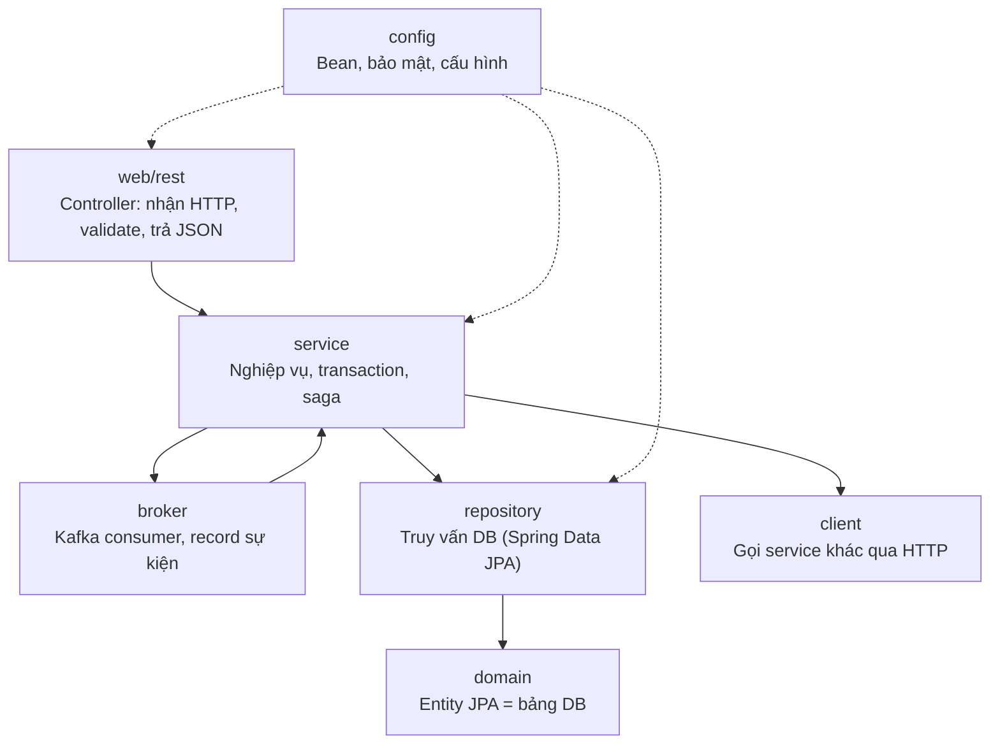

# TicketRush: tổng quan dự án

> Tài liệu này trả lời câu hỏi **"hệ thống gồm những gì, mỗi phần làm gì, nằm ở đâu"**.
> Muốn hiểu **vì sao** code được viết như vậy và học các kỹ thuật bên trong, đọc [learn.md](learn.md).

## 1. Dự án giải quyết bài toán gì

TicketRush là nền tảng bán vé sự kiện/concert, được thiết kế cho khoảnh khắc khó nhất: **mở bán**. Hàng nghìn
người cùng bấm "Mua" cho vài trăm ghế trong vài giây. Hệ thống phải:

1. **Không bao giờ bán quá số ghế** (oversell), kể cả khi hàng trăm request tranh đúng một dòng dữ liệu.
2. **Không trừ tiền hai lần** khi người mua bấm lại, mạng chập chờn hay cổng thanh toán gửi callback nhiều lần.
3. **Không treo cả hệ thống** khi một service con chậm hoặc chết.
4. **Tự dọn dẹp**: ghế giữ quá 10 phút mà chưa thanh toán phải tự trả lại cho người khác.
5. **Quan sát được**: biết request đi qua những service nào, chậm ở đâu, bán được bao nhiêu.

Mục tiêu phụ: đây là project portfolio, nên **kiến trúc, tài liệu và số liệu đo được** quan trọng hơn số lượng tính năng.

## 2. Kiến trúc tổng thể



**Nguyên tắc xuyên suốt:**

| Nguyên tắc | Ý nghĩa trong dự án |
|---|---|
| Database per service | Mỗi service có PostgreSQL riêng, không service nào đọc DB của service khác. Tham chiếu chéo chỉ lưu id (`ticketTypeId`, `orderId`), không có foreign key xuyên DB |
| Đồng bộ khi cần câu trả lời ngay | Giữ ghế và mở thanh toán là REST, vì người mua phải biết ngay "còn vé không", "trả tiền ở đâu" |
| Bất đồng bộ cho kết quả đến sau | Kết quả thanh toán, ghế hết hạn, loại vé mới là sự kiện Kafka |
| Mọi bước đều idempotent | Gọi lại bao nhiêu lần cũng cho cùng kết quả, nên được phép retry |
| Không tin client | Giá lấy từ catalog, không lấy từ request; webhook phải có chữ ký; mã vé QR có HMAC |

## 3. Các service

| Service | Port | Trách nhiệm | Dữ liệu chính | Phát sự kiện | Nhận sự kiện |
|---|---|---|---|---|---|
| **gateway** | 8080 | Cửa ngõ duy nhất: định tuyến `/services/{tên}/**`, đăng nhập OIDC, UI quản trị, rate limit, phòng chờ ảo | Người dùng (đồng bộ từ Keycloak); hàng chờ trong Redis | — | — |
| **catalog** | 8081 | Sự kiện, địa điểm, loại vé, giá; API công khai cho trang người mua | `venue`, `event`, `ticket_type` | `catalog.ticket-type.v1` | — |
| **inventory** | 8082 | Tồn kho từng loại vé, giữ ghế 10 phút, chống bán quá | `ticket_stock`, `stock_hold` | `inventory.hold-expired.v1` | `catalog.ticket-type.v1` |
| **order** | 8083 | Checkout, đơn của tôi, huỷ đơn, **saga điều phối** thanh toán, vé điện tử, soát vé | `ticket_order`, `order_item`, `ticket` | `order.events.v1` | `payment.result.v1`, `inventory.hold-expired.v1` |
| **payment** | 8084 | Mở thanh toán, nhận webhook, hoàn tiền, hết hạn | `payment`, `payment_webhook_event` | `payment.result.v1` | — |

Ngoài ra, mỗi service phát sự kiện đều có bảng `outbox_event`, và mỗi service nhận sự kiện có bảng `processed_event` (xem mục 6).

**Hạ tầng đi kèm:**

| Thành phần | Vai trò |
|---|---|
| Keycloak | Đăng nhập (OAuth2/OIDC). Realm `jhipster`: người dùng có `ROLE_USER`/`ROLE_ADMIN`; client `internal` (service gọi service) có `ROLE_SERVICE` |
| Consul | Service discovery (service tìm nhau theo tên) và cấu hình dùng chung (`docker-compose/central-server-config/`) |
| Kafka (KRaft, 1 node) | Chuyển sự kiện giữa các service |
| Redis | Cache lớp 2 cho catalog; token bucket rate limit và hàng chờ cho gateway |
| Prometheus, Grafana, Tempo | Metrics, dashboard, distributed tracing (`observability/`) |
| Caddy | Reverse proxy và HTTPS khi deploy lên VM (`deploy/`) |

## 4. Bên trong một service: các lớp (layer)

Mọi service backend đều tổ chức theo cùng một kiểu phân lớp. Các mũi tên dưới đây là hướng **được phép gọi**:



| Lớp | Package | Chứa gì | Ví dụ |
|---|---|---|---|
| **domain** | `domain/` | Entity JPA, ánh xạ 1-1 với bảng. Không chứa logic gọi ra ngoài | `TicketStock`, `StockHold`, `Order`, `Payment`, `OutboxEvent` |
| **repository** | `repository/` | Interface Spring Data: query, khoá dòng, UPDATE có điều kiện | `TicketStockRepository.tryTake`, `PaymentRepository.lockByProviderRef` |
| **service** | `service/` | Nghiệp vụ và ranh giới transaction. Các service tự viết nằm trong package con theo nghiệp vụ | `service/reservation`, `service/checkout`, `service/saga`, `service/flow`, `service/outbox` |
| **web/rest** | `web/rest/` | Controller REST. Mỏng: validate input, gọi service, trả mã HTTP đúng | `CheckoutResource`, `InternalReservationResource`, `PaymentWebhookResource` |
| **broker** | `broker/` | Consumer Kafka (`Consumer<Message<T>>`) và các record mô tả sự kiện | `TicketTypeEventsConsumer`, `PaymentResultEventsConsumer` |
| **client** | `client/` (order) | Interface `@HttpExchange` gọi service khác, bọc Resilience4j | `InventoryClient`, `PaymentClient`, `ResilientClient` |
| **config** | `config/` | Cấu hình Spring: bảo mật, `Clock`, client HTTP, rate limit | `SecurityConfiguration`, `ServiceClientsConfiguration` |
| **security** | `security/` | Hằng số quyền, tiện ích lấy user hiện tại | `AuthoritiesConstants.SERVICE` |

Luật phân lớp được **kiểm tra tự động** bằng ArchUnit (`src/test/java/.../TechnicalStructureTest.java`). Ví dụ: controller không được gọi thẳng repository của tầng khác, và chỉ `config` hoặc `service` mới được dùng `broker`.

### Code sinh ra và code tự viết

Phần lớn mã CRUD do **JHipster** sinh từ [`ticketrush.jdl`](../ticketrush.jdl): entity, repository cơ bản, `XxxService`/`XxxServiceImpl`, DTO, mapper, `XxxResource`, test CRUD. **Phần đáng học là code tự viết**, nằm ở:

| Service | Code tự viết quan trọng |
|---|---|
| catalog | `service/outbox/*`, `service/event/TicketTypeChanged`, `service/publiccatalog/*`, `service/admin/*` |
| inventory | `service/reservation/*` (giữ ghế, hết hạn), `service/StockSyncService`, `repository/TicketStockRepository`, `repository/ProcessedEvents`, `web/rest/AdminStockResource`, `broker/*` |
| order | `service/checkout/*` (gồm `QueuePasses`), `service/saga/OrderSaga`, `service/ticket/*`, `service/admin/*`, `client/*`, `config/ServiceClientsConfiguration`, `broker/*` |
| payment | `service/flow/*` (vòng đời thanh toán, webhook), `service/provider/*` (Mock provider, HMAC), `web/rest/AdminPaymentResource` |
| gateway | `config/RateLimitConfiguration`, `service/waitingroom/WaitingRoomService` + `web/rest/WaitingRoomResource`, phần CSRF trong `config/SecurityConfiguration` |

Commit trong git cũng tách bạch: `chore: generate ...` là code sinh ra; `feat:`/`fix:` là code tự viết.

## 5. Luồng chính: mua một vé

```mermaid
sequenceDiagram
    autonumber
    actor B as Người mua
    participant G as gateway
    participant O as order
    participant C as catalog
    participant I as inventory
    participant P as payment
    participant K as Kafka

    B->>G: POST /services/order/api/checkout (Idempotency-Key)
    G->>G: rate limit theo user (Redis)
    G->>O: chuyển tiếp (kèm header X-Queue-Pass nếu có)
    O->>C: lấy giá loại vé và trạng thái sự kiện (không tin giá từ client)
    O->>O: sự kiện phải PUBLISHED; bật phòng chờ thì pass phải hợp lệ (không thì 428)
    O->>O: lưu đơn PENDING (transaction riêng)
    O->>I: POST /api/internal/reservations (keyed by orderId)
    I->>I: UPDATE ... WHERE available >= qty, tạo hold 10 phút
    I-->>O: giữ ghế OK (hoặc 409 hết vé)
    O->>P: mở thanh toán (keyed by orderId)
    P-->>O: paymentUrl
    O-->>B: 201 AWAITING_PAYMENT + paymentUrl
    B->>P: trả tiền ở trang cổng thanh toán
    P->>P: webhook có chữ ký, lưu inbox, áp dụng đúng 1 lần
    P->>K: payment.result.v1 (qua outbox)
    K->>O: OrderSaga.onPaymentResult
    O->>I: confirm ghế
    O->>O: CONFIRMED, phát hành vé QR, order.events.v1 (qua outbox)
```

Các nhánh rẽ (đều do `OrderSaga` xử lý):

| Tình huống | Kết quả |
|---|---|
| Hết vé lúc giữ ghế | 409, đơn `FAILED` (`SOLD_OUT`) |
| Thanh toán bị từ chối hoặc quá hạn | Trả ghế → `FAILED` / `EXPIRED` |
| Hết 10 phút giữ ghế trước khi trả tiền | Huỷ thanh toán → `EXPIRED` |
| Tiền về **sau khi** ghế đã hết hạn | **Hoàn tiền** → `REFUNDED` |
| Người mua tự huỷ | Huỷ thanh toán, trả ghế → `CANCELLED` |

## 6. Sự kiện Kafka

| Topic | Bên phát | Bên nhận | Key | Nội dung |
|---|---|---|---|---|
| `catalog.ticket-type.v1` | catalog | inventory | ticketTypeId | Loại vé được tạo/đổi số lượng (tổng tuyệt đối) |
| `inventory.hold-expired.v1` | inventory | order | orderId | Ghế của đơn đã hết hạn và được trả lại |
| `payment.result.v1` | payment | order | orderId | Thanh toán SUCCEEDED / FAILED / EXPIRED (cờ `late` nếu tiền về muộn) |
| `order.events.v1` | order | (notification sau này) | orderId | Đơn CONFIRMED / CANCELLED / EXPIRED / REFUNDED |

Mọi sự kiện đều đi qua **transactional outbox** (ADR 0004), mang header `eventId` để bên nhận bỏ qua bản trùng, và header `traceparent` để tracing đi xuyên qua Kafka.

## 7. Mô hình bảo mật

| Ai | Token | Được làm gì |
|---|---|---|
| Khách vãng lai | Không | Xem sự kiện công khai (`/api/public/**`), trang thanh toán giả lập, gửi webhook (phải có chữ ký) |
| Người mua (`ROLE_USER`) | Token người dùng từ Keycloak | Checkout, xem và huỷ đơn **của mình**, ví vé |
| Quản trị (`ROLE_ADMIN`) | Token người dùng | Tạo/sửa sự kiện, đổi trạng thái, bật phòng chờ; xem tồn kho, đơn, thanh toán, webhook (chỉ đọc); dashboard, soát vé |
| Service khác (`ROLE_SERVICE`) | Token client-credentials của client `internal` | Gọi `/api/internal/**`: giữ/confirm/trả ghế, mở/huỷ/hoàn thanh toán; order đọc loại vé ở catalog (`GET /api/ticket-types/{id}`) |

Vì ai cũng tự đăng ký tài khoản được, CRUD sinh sẵn của catalog (`/api/events`, `/api/venues`, `/api/ticket-types`)
chỉ dành cho `ROLE_ADMIN`; riêng `GET /api/ticket-types/{id}` mở thêm cho `ROLE_SERVICE`.

Token của người mua **không bao giờ** được chuyển tiếp xuống inventory hay payment. Nếu được chuyển tiếp, người mua có thể tự gọi API giữ ghế và giữ hết vé.

## 7b. API chính (ngoài CRUD sinh sẵn)

Đường dẫn dưới đây là đường dẫn trong service; qua gateway thì thêm tiền tố `/services/{tên}` (riêng phòng chờ nằm
ngay trên gateway).

| Ai gọi | Service | API | Việc |
|---|---|---|---|
| Khách | catalog | `GET /api/public/events`, `/{slug}`, `/by-id/{id}` | Sự kiện đang bán (kèm cờ `waitingRoom`) |
| Khách | inventory | `GET /api/public/availability?ticketTypeIds=` | Số ghế còn lại |
| Người mua | order | `POST /api/checkout` (`Idempotency-Key`, `X-Queue-Pass`) | Đặt vé, giữ ghế 10 phút |
| Người mua | order | `GET /api/my-orders`, `/{code}`, `POST /{code}/cancel` | Đơn của tôi |
| Người mua | order | `GET /api/my-tickets` | Vé điện tử, mỗi ghế một vé, có QR ký HMAC |
| Người mua | gateway | `POST`/`GET /api/waiting-room/{eventId}` | Vào hàng chờ, xem vị trí, nhận pass |
| Quản trị | catalog | `GET/POST /api/admin/events`, `PUT /{id}`, `POST /{id}/status` | Sự kiện + địa điểm + loại vé trong một lần gọi |
| Quản trị | inventory | `GET /api/admin/stock?ticketTypeIds=`, `/api/admin/holds/expiring` | Đã bán / đang giữ / còn lại |
| Quản trị | order | `GET /api/admin/orders`, `/{code}`, `/api/admin/stats/sales`, `POST /api/admin/check-in` | Tra đơn, doanh số, soát vé |
| Quản trị | payment | `GET /api/admin/payments`, `/api/admin/webhooks` | Giao dịch, nhật ký webhook (kèm số lần gửi lại) |
| Quản trị | gateway | `GET /api/admin/waiting-room/{eventId}` | Độ dài hàng chờ |

## 8. Cấu trúc repository

| Đường dẫn | Nội dung |
|---|---|
| `ticketrush.jdl` | Nguồn chuẩn cho code sinh ra (app, entity, quan hệ) |
| `gateway/`, `catalog/`, `inventory/`, `order/`, `payment/` | 5 service Spring Boot (mỗi service một Maven project độc lập) |
| `ui-prototype/` | SPA cho người mua (React 19 + Vite + Bootstrap), gọi API thật qua gateway |
| `docker-compose/` | Stack chạy local: Consul, Keycloak, Kafka, Redis, mỗi service một PostgreSQL |
| `observability/` | Prometheus, Grafana (dashboard `ticketrush.json`), Tempo |
| `load/` | Kịch bản k6 (`browse.js`, `on-sale.js`), kết quả trong `load/results/` |
| `deploy/` | Triển khai lên một VM: `compose.prod.yml`, Caddy, `deploy.sh` |
| `scripts/` | `harden-compose.py` (áp lại chỉnh sửa sau khi sinh code), `make-readonly*.py`, `e2e/` |
| `docs/adr/` | Quyết định kiến trúc: 0001 Consul, 0002 Saga, 0003 Chống oversell, 0004 Outbox |
| `.github/workflows/ci.yml` | CI: test các service thay đổi, UI gateway, kiểm tra compose |

## 9. Lộ trình và trạng thái

| Giai đoạn | Nội dung | Trạng thái |
|---|---|---|
| 1 | JDL, gateway + catalog, Keycloak, Consul, PostgreSQL, chạy end-to-end | Xong |
| 2 | Redis, Kafka, inventory (giữ ghế, chống oversell), order (checkout idempotent), rate limit | Xong |
| 3 | payment, saga + bù trừ, outbox, webhook idempotent, Resilience4j, CI | Xong |
| 4 | OpenTelemetry, Prometheus/Grafana/Tempo, k6, deploy VM, SPA người mua, phòng chờ ảo, vé QR, soát vé | Đang hoàn thiện |
| Sau đó | notification (email khi CONFIRMED), VNPay/MoMo sandbox thật, i18n tiếng Việt cho UI admin | Chưa làm |

## 10. Chạy và kiểm tra

Hướng dẫn đầy đủ nằm trong [README](../README.md). Tóm tắt:

```bash
cp docker-compose/.env.example docker-compose/.env        # điền secret
for app in catalog inventory order payment gateway; do (cd $app && ./mvnw -ntp -Pprod -DskipTests verify jib:dockerBuild); done
docker compose -f docker-compose/docker-compose.yml up -d --wait
```

| Muốn kiểm tra | Lệnh |
|---|---|
| Một test cụ thể (nhanh) | `./mvnw -ntp verify -DskipJib -Dtest=none -Dsurefire.failIfNoSpecifiedTests=false -Dit.test=ReservationServiceIT` |
| Toàn bộ một service | `cd inventory && ./mvnw -ntp verify` |
| End-to-end qua gateway | `docker compose ... -f scripts/e2e/compose.override.yml up -d --wait` rồi `python scripts/e2e/e2e.py` (tự tạo user `e2e-admin` cho các API quản trị) |
| Tải mở bán | `load/run.sh` (k6) |

## 11. Giới hạn đã biết

- Kafka, Consul, Keycloak chạy 1 node ở chế độ dev, chưa có HA.
- Mỗi loại vé chỉ có một dòng tồn kho, nên dòng đó là điểm tuần tự hoá khi mở bán. Hướng mở rộng: phòng chờ ảo để giới hạn người vào (đã có), sau đó chia tồn kho thành nhiều "bucket".
- Cổng thanh toán thật (VNPay/MoMo) mới có interface, đang chạy bằng Mock provider.
- Trên laptop 16 GB chạy cả stack, độ trễ đo bằng k6 cao hơn nhiều so với môi trường thật. Hãy đọc số liệu trong `load/results/` kèm bối cảnh máy đo.
